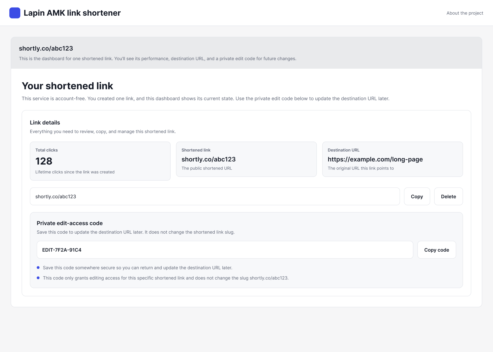
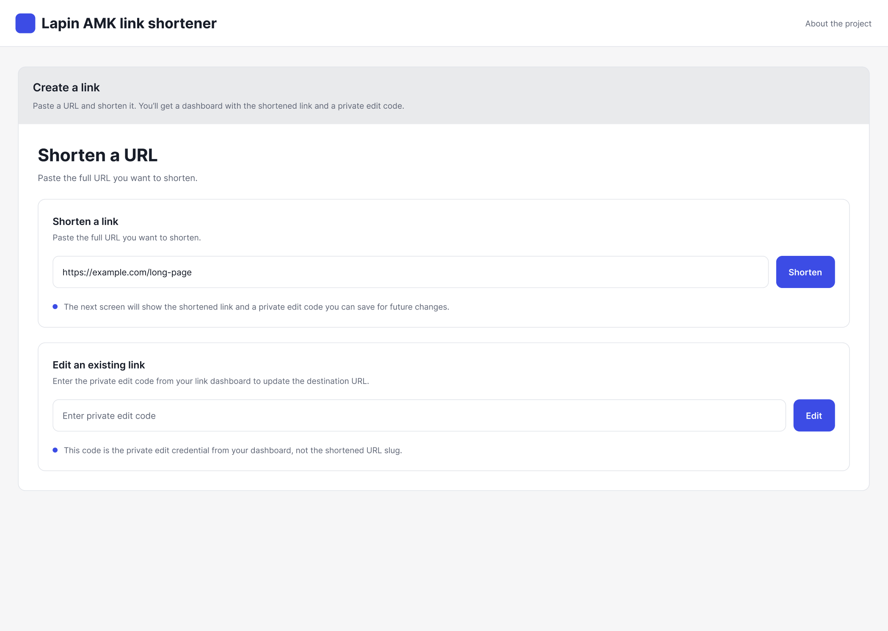
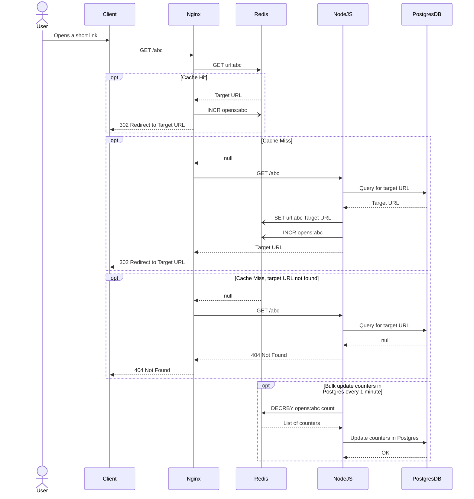
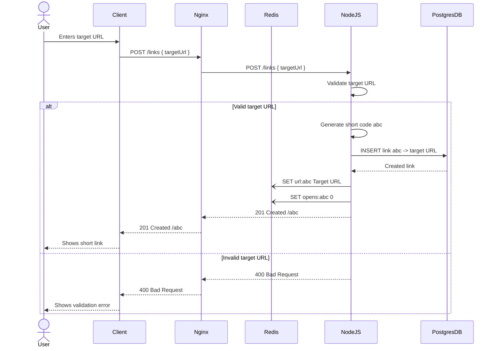
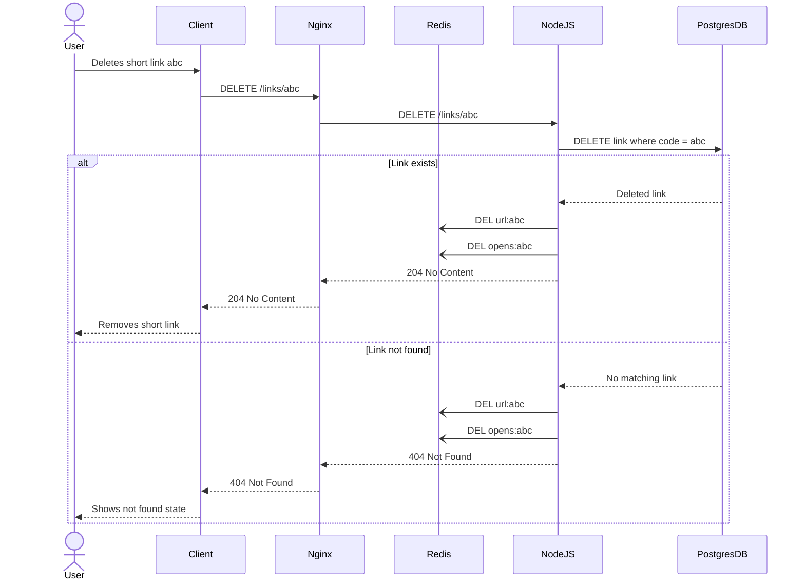

# Lapin AMK link shortener project

This project is focused on building a web app for creating and serving short links like Bitly.

The main goal is to achieve a super low latency on a Read path (p50 <1ms at 50k RPS on a cache hit) and create a proper CI/CD pipeline using AWS for both FE and BE apps.

App's layout:




## Technical stack

The repository is a monorepo, which works on top of Turborepo (https://turborepo.dev/) and has several apps inside.

### Frontend

A frontend part is a React app, which uses a Tailwind and tools from a Tanstack project.

### Backend

A backend part is written in TypeScript and runs on Bun with Fastify. OpenResty is the public reverse proxy and resolves Redis cache hits before traffic reaches Bun.

### Local reverse proxy

`bun run infra:up` starts the production-like Docker Compose stack. OpenResty
is available on port `8080`: `/api/` proxies to the Bun API, `/client/` serves
the React SPA, and a seven-character short code at `/{code}` is read from Redis
and redirected directly. Cache misses and Redis outages fall back internally to
the API, which resolves Postgres, repairs Redis, and returns either `302` or
`404`. Other paths temporarily return a `302` redirect to Google.

For hot reload, run `bun run infra:dev:up` once, then run `bun run dev`. The
OpenResty development proxy continues to serve `http://localhost:8080`, while
the API and client run from the host with file watching.

### Read-path load test

The read-path k6 scenario creates and warms one short link, then measures only
the OpenResty `302` response. It does not follow the destination URL, so remote
site latency is excluded. Install [k6](https://grafana.com/docs/k6/latest/set-up/install-k6/),
start the production-like stack, migrate the database, then run:

```sh
bun run infra:up
bun run db:migrate
bun run load:read:smoke
```

`bun run load:read` defaults to 100 requests per second for 30 seconds. Tune it
with environment variables such as `READ_PATH_RATE`, `READ_PATH_DURATION`,
`READ_PATH_PRE_ALLOCATED_VUS`, and `READ_PATH_MAX_VUS`. Local Docker results
are a development baseline only. To assess the architecture target of 50k RPS
and p50 below 1 ms, use dedicated production-like infrastructure and one or
more external load generators, for example:

```sh
READ_PATH_RATE=50000 READ_PATH_PRE_ALLOCATED_VUS=500 READ_PATH_MAX_VUS=5000 \
READ_PATH_P50_MS=1 READ_PATH_P95_MS=5 bun run load:read
```

### Data storage

Links will be persistently stored in Postgres and added to Redis cache. Redis cache will be also responsible for counting link opens for analytics. Every minute counters will be updated in Postgres.

New links are written to Postgres first, then cached as `url:{code}` and
`opens:{code}` in Redis. OpenResty reads these keys on the redirect fast path;
the API repairs missing entries from Postgres. A temporary cache failure does
not prevent creation or resolution of a durable link.

## Workspace packages

Internal code is scoped under `@lapinamk-ls/*`. `@lapinamk-ls/domain` contains
link business rules and repository ports, `@lapinamk-ls/database` contains
Kysely/Postgres persistence and migrations, `@lapinamk-ls/cache` owns Redis
key operations, and `@lapinamk-ls/cli` contains operational commands. Create a
link locally after starting infrastructure with:

```sh
bun run db:migrate
bun run cli link:create https://example.com
```

`POST /api/links` accepts `{ "targetUrl": "https://example.com" }` and returns
the new public short URL plus a manager code. Store the manager code when it is
returned: dashboard access will use it in a future increment, and ordinary API
responses will not reveal it again.

## Architecture diagrams

### Read path



### Write path



### Delete path



### Testing

Code will be covered with unit & E2E tests. Load testing will be done using k6 (https://k6.io/).

## Deployment

A full CI/CD will be configured and an app will be deployed to AWS every time a commit goes to the master branch.

### Frontend

A client app will be built, deployed and served in S3.

### API, DB & Cache

The rest of the application will be deployed in EC2 in Docker containers.
